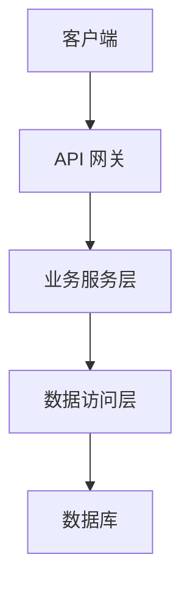
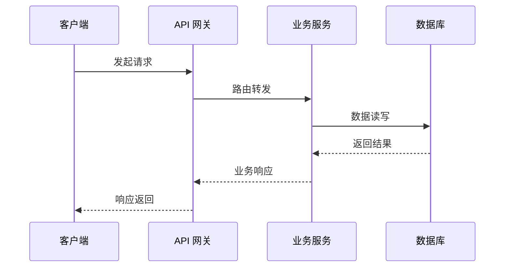

<div align="center">

# id_x_005: UGO-学生管理系统

**UGO 学生管理系统 —— 预留结构体，静候业务填充**


</div>

---

## 1. 简介 (Introduction)

**UGO 学生管理系统 —— 预留结构体，静候业务填充**

`id_x_005` 是 UGO 学生管理系统的结构体占位项目（结构体_005）。当前仓库仅包含 `LICENSE`（AGPL-3.0）文件，作为项目骨架预留，尚未填充具体业务代码。后续将在此结构体基础上逐步实现学生信息管理、课程管理、成绩管理等业务逻辑。

## 2. 核心特性 (Features)

待规划，预计包括但不限于：

- 学生信息管理（录入、查询、修改、归档）
- 课程与选课管理
- 成绩录入与统计分析
- 用户权限与角色管理

## 3. 项目亮点 (Highlights)

待规划，预计包括：

- 基于 UGO 引擎的统一模型结构体规范
- 模块化设计，便于扩展与维护
- 开源协议透明（AGPL-3.0）

## 4. 技术栈 (Tech Stack)

| 层级 | 技术选型 | 说明 |
|------|----------|------|
| 后端框架 | 待定 | 待规划 |
| 前端框架 | 待定 | 待规划 |
| 数据库 | 待定 | 待规划 |
| 缓存 | 待定 | 待规划 |
| 部署方式 | 待定 | 待规划 |

## 5. 整体架构图 (Overall Architecture Diagram)



> 注：当前为占位架构图，待业务逻辑确定后补充细化。

## 6. 请求流转图 (Request Flow Diagram)



> 注：当前为占位流程图，待业务逻辑确定后补充细化。

## 7. 目录结构 (Directory Structure)

```text
id_x_005/
├── LICENSE          # AGPL-3.0 开源协议
└── README.md        # 项目说明文档
```

## 8. API 接口文档 (API Documentation)

待规划。业务接口尚未定义，将在业务代码填充后补充完整的 API 文档，包括接口路径、请求参数、响应格式与错误码说明。

## 9. 快速部署 (Quick Deploy)

待规划。部署方案将在技术栈确定后补充，预计提供本地开发环境搭建与容器化部署两种方式。
